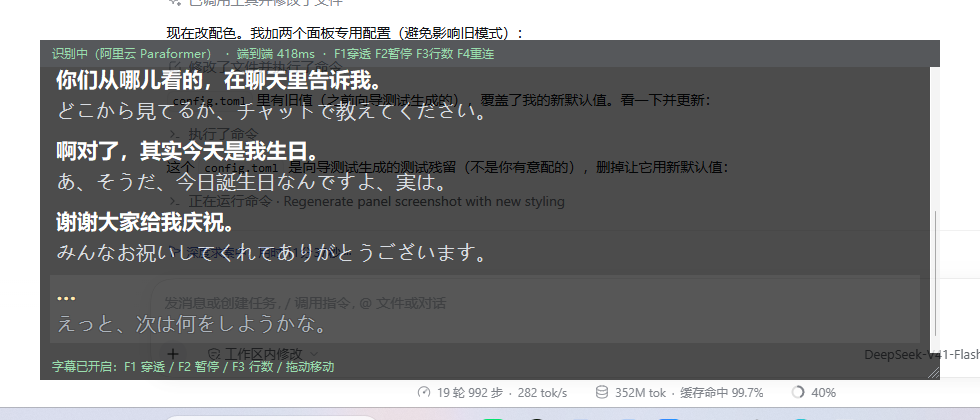
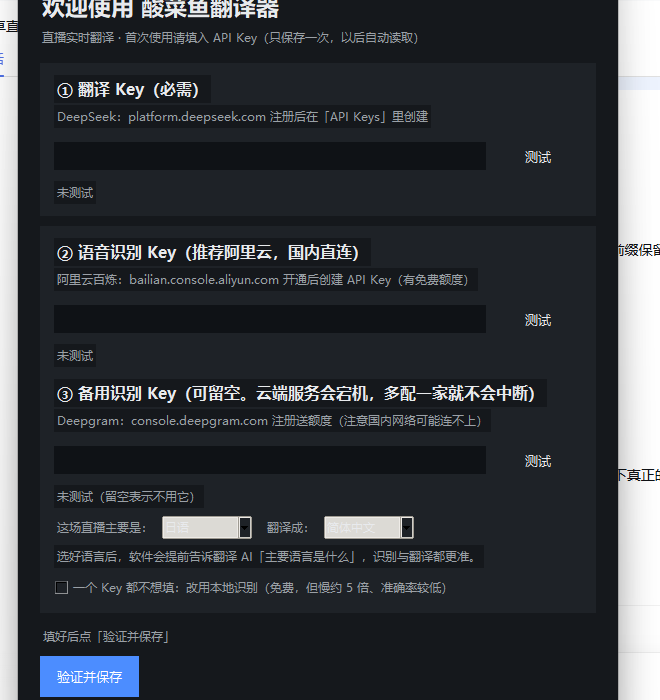
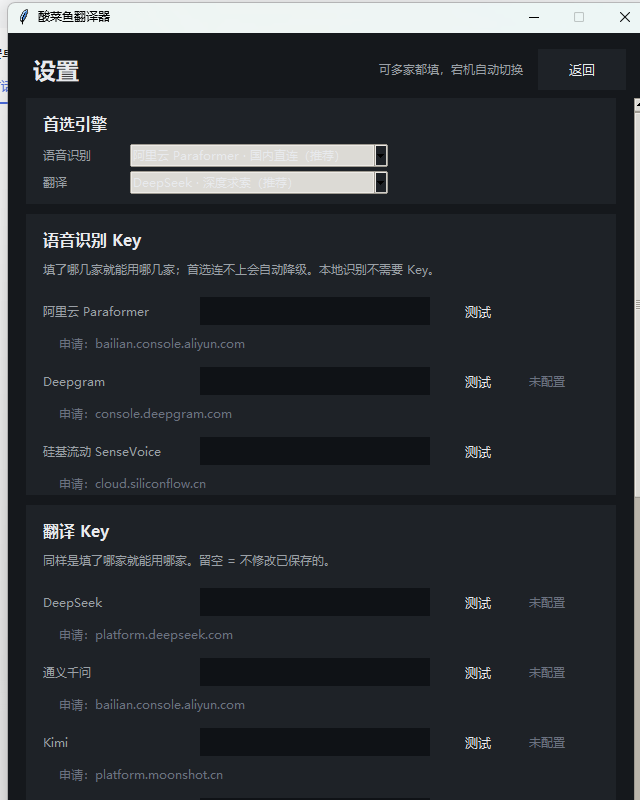

# 酸菜鱼翻译器 · SuanCaiYu Translator

> 看外语直播（尤其是日语）时的实时中文字幕悬浮窗

看外语直播时，把**电脑正在播放的声音**实时转成中文字幕，以**置顶悬浮窗**挂在直播画面前面。
**主要场景：日语直播 → 中文**（也支持英语等其它语言）。

这是"先验证效果"的 Windows 原型：把整条链路（内录 → 流式识别 → 流式翻译 → 悬浮字幕）跑通并量化延迟，
验证通过后再按 [ANDROID.md](ANDROID.md) 移植到安卓。

日语直播实测效果：


---

## 0. 先搞清楚：识别 ≠ 翻译（这是两件事）

| 环节 | 做什么 | 可选厂商 | 费用 |
|---|---|---|---|
| **语音识别 (ASR)** | 把「声音」变成「日文文字」 | **阿里云 Paraformer**（默认）/ Deepgram / 硅基流动 / 本地 Whisper | 有免费额度 / 本地免费 |
| **翻译 (MT)** | 把「日文文字」变成「中文文字」 | **DeepSeek**（默认）/ 通义千问 / Kimi / 硅基流动 / 智谱 / OpenAI | 极便宜 |

### 两层都支持"配多家 + 宕机自动切换"

云端服务会挂（千问就出现过整晚不可用）。所以每一层都可以配多家，首选连不上时自动轮到下一个：

```
识别： 阿里云 Paraformer  ──▶  Deepgram  ──▶  硅基流动  ──▶  本地 Whisper（永远可用）
翻译： DeepSeek          ──▶  通义千问  ──▶  Kimi  ──▶  硅基流动  ──▶  智谱  ──▶  OpenAI
```

两条链都是**只尝试配了 Key 的那几家**。实测降级日志：

```
# 识别：故意用无效的阿里云 Key
[pipeline] 阿里云 Paraformer 连接失败: DashScope API Key 无效（401/403）
[pipeline] 阿里云 Paraformer 未能建立识别，尝试下一个…
[asr] Deepgram 已连接 (model=nova-2)
原文  : このゲームはオープンワールドでグラフィックが本当にすごいん
译文  : 这个游戏是开放世界的，画面真的超厉害。   [500ms]

# 翻译：故意用无效的 DeepSeek Key
翻译降级链 : deepseek → qwen
[translate] 已提前告知语言背景：主要语言 日语     ← DeepSeek 预热
[translate] 已提前告知语言背景：主要语言 日语     ← 通义千问预热
原文  : 今日は、皆さんに新しいゲームを紹介したいと思います。
译文  : 今天想给大家介绍一款新游戏。   [796ms]
```

**所以建议识别、翻译各配两家以上**，一家挂了另一家顶上，字幕不中断。

---

## 1. 语言选择：提前告诉 AI「主要是什么语言」

在首次配置向导或设置页选好源语言（如「日语」）后，软件会在**正式翻译之前**
先单独发一条请求，把语言背景告诉每一个翻译模型：

> 接下来你会收到一段直播语音的实时识别文本…这段直播的**主要语言是日语**…
> 遇到看起来像英文单词或罗马字的部分，先考虑它是不是日语里的外来语、专有名词或
> 口头禅，而不是直接当成英文去翻译。但也别死板：如果确实出现了其它语言
> （英文术语、人名、歌词等），按它实际的语言理解即可。

这么做有两个好处：

1. **减少误判**：直播里日英混说、片假名外来语很多，说明白"主要是日语"能明显减少
   把英文术语硬翻错的情况。措辞用"主要/优先"而不是"必须"，因为语音里**不会**
   100% 是单一语言。
2. **顺带省延迟**：这一条同时把 HTTP 连接建好了，第一句台词少等 300~600ms
   （实测端到端从 593ms 降到 531ms）。

同时识别那一侧也用同一个语言设置：Paraformer 的 `language_hints`、Deepgram 的
`language`，都按你选的语言走，比让它们自己猜更准更快。

设置页里改成 `自动识别`、或取消勾选「提前告诉翻译 AI」，就不再发这条提示。

---

## 1.5 翻译时机：识别一直在跑，翻译等断句（重要）

这是针对「语速快的主播」做的一次关键调整。

### 原来的问题

识别与翻译原来是**同步触发**的：ASR 每吐一个中间结果，只要比上次长 6 个字符、
且距上次超过 350ms，就立刻发一次翻译请求。快语速主播 1 秒能蹦 3~4 个中间结果，
于是出现两个毛病：

1. **碎片化**：模型每次只看到半句话，翻出来的中文前后接不上
2. **烧 token**：同一句话被反复翻译好几遍

用 mock 的快速语音流实测（3 句日语，350ms/片段）：

```
【边说边翻（旧）】
  1. [  7字] 今日は皆さんに                                    ← 只有半句
  2. [ 24字] 今日は皆さんに新しいゲームを紹介したいと思います      ← 同一句又翻一遍
  3. [ 24字] 今日は皆さんに新しいゲームを紹介したいと思います      ← 再翻一遍（纯浪费）
  4. [  7字] このゲームはオ
  5. [ 32字] このゲームはオープンワールドでグラフィックが本当にすごいんですよ
  6. [ 32字] このゲームはオープンワールドでグラフィックが本当にすごいんですよ
  ...
  翻译请求 9 次，总输入 173 字符
```

**同一句话翻了 3 遍**，其中第一遍只有 7 个字符。

### 现在的做法

改成**识别归识别、翻译归翻译**的两条路径（与千问那套处理逻辑一致）：

```
音频 ──▶ ASR ──▶ 中间结果：只更新屏幕上的原文（不翻译）
                  │
                  └─▶ 攒进缓冲区
                          │
        服务端判定这句说完了 ─┴─▶ 整句一次性交给翻译
```

翻译的触发条件（先满足哪个算哪个）：

| 条件 | 说明 |
|---|---|
| **服务端断句** | Paraformer `sentence_end` / Deepgram `speech_final`，最主要的触发点 |
| **标点软断句** | 攒到一半容量以上且末尾是 `。！？` —— 见下方说明 |
| **攒够 60 字符** | 防止一口气说很久导致字幕一直空着 |
| **静默 1.2 秒** | 服务端没给断句信号时的兜底 |

实测效果（同一段音频）：

```
【等断句整句翻（新）】
  1. [ 24字] 今日は皆さんに新しいゲームを紹介したいと思います
  2. [ 32字] このゲームはオープンワールドでグラフィックが本当にすごいんですよ
  3. [ 20字] とりあえず最初の30分だけ遊んでみますね

  翻译请求 9 → 3 次   （-67%）
  总输入字符 173 → 76 （-56%）
  每句都是完整句
```

### 为什么要"标点软断句"

用一个真实的日语直播回放（B 站，70 分钟生日回，全程有 BGM）做了音频分析，
发现一个**反直觉的事实**：这类直播音频的动态范围被压得极平 ——

```
分段响度(200ms 窗) 分布:
  P10 = -24.7 dB   P50 = -23.9 dB   P90 = -22.9 dB
  → 全程波动只有约 1 dB，找不到任何停顿
```

后果是：**靠能量阈值做静音检测完全失效**（Silero VAD 甚至把整段判成 0 句话），
"静默兜底"在这种音源上几乎不会触发，只剩"攒够字符数硬切"——而那会在句子中间切断。

好在 Paraformer 与 Deepgram 都开了标点预测。用**末尾是否为句末标点**当断点，
既不依赖音频能量，也不会切在句子中间：

```
输入：7 个中间结果，最后一条 40 字，全程无停顿
翻译请求 2 次：
  1. [29字] えっとね、今日はですね、みんなに新しいゲームを紹介します。   ← 断在句号，自然
  2. [40字] …それでこのゲームはね、                                  ← 到长度上限
```

### 怎么关掉

设置页里取消勾选「等主播说完一句再整句翻译」，就回到"边说边翻"的行为
（字幕出现更快，但会碎片化、更费 token）。

命令行验证这个改动的效果：

```powershell
python tools\compare_sentence_mode.py
```

---

## 1.6 自动增益：不同直播的音量能差 11 倍

这是用真实直播录像测出来的一个**致命问题**。

### 现象

拿一场 B 站日语直播回放（70 分钟，全程有 BGM）做端到端测试，结果
**一句话都识别不出来**：

```
[info] Paraformer 已连接
（然后 90 秒里一条文本事件都没有）
```

但同一个 Key、同一套代码，用标准测试样本完全正常。对比两者的电平就明白了：

| 音频 | RMS | 峰值 | 识别结果 |
|---|---|---|---|
| 标准测试样本 | **0.1393** | 0.693 | 正常，partial/final 流完整 |
| 这场直播的音轨 | **0.0120** | 0.209 | **一条都识别不出来** |

**低了 11.6 倍。** 后果是连锁的：

1. 识别侧把整段判成"没在说话"（低于 VAD 阈值）
2. 服务端 VAD 同样判成无语音，返回 0 个结果
3. 界面上就是"在跑但没字幕"——**用户完全不知道问题出在音量上**

### 验证

把同一段音频手动增益 4.3 倍（峰值 0.209 → 0.9）后，识别**立刻恢复正常**：

```
[partial] あ
[final  ] 句尾 あと、さ。
[partial] アイドルとかの人？
[final  ] 句尾 アイドルとかの人？ がね
[final  ] 句尾 でも、さっかり。
```

### 解决

在音频送进识别之前加了一层**流式自动增益**（`livesub/agc.py`）：

| 设计 | 原因 |
|---|---|
| 用**滑动峰值**定增益，不用均值 | 均值会被持续的背景音乐拉高，有人说话时反而不增益 |
| 快攻慢放 | 突然降增益会让正在说的话变小 |
| 上限 12x | 静音时不能无脑放大，否则噪声被抬起，服务端 VAD 会一直以为有人在说 |
| 低于噪声门限不参与 | 真静音不该被放大 |
| 增益后硬限幅 | int16 溢出会 wrap 成反相，是很响的爆音，识别直接崩 |

实测（单元测试）：

```
输入峰值 0.060 → 输出 0.364   增益 6.1x    ← 极低电平被救回来
输入峰值 0.209 → 输出 0.386   增益 1.8x    ← 就是那场 B 站直播
输入峰值 0.350 → 输出 0.401   增益 1.15x   ← 正常电平几乎不动
输入峰值 0.002 → 输出 0.002   增益 1.0x    ← 真静音不放大
```

**管线级验证**（用**未经手动增益**的原始低电平音频）：

```
诊断工具直连 ASR（无 AGC）:  只有 あ / あと、さ。 等零碎片段
完整管线（有 AGC）:          てかこんなにいっぱいさ見てるとさ、
                            ビリビリの社員の人監視してない大丈夫ね。
译文:                       话说，看这么多（弹幕）的话，
                            Bilibili的员工不会在盯着（我）吧，没事吗？
```

> 关掉它：配置里设 `audio.auto_gain = false`。

---

## 1.7 面板模式：不再是"滚动字幕"，而是可拉伸的固定面板

这是针对「**快语速下字幕跳得太快、根本来不及读**」做的一次形态改造。

### 原来的问题

旧悬浮窗是"自适应高度的滚动字幕"：窗口高度严格贴住内容，只显示最新 1~2 行，
新内容一来就把旧的整块顶掉。快语速主播一两秒就换一批文字 ——
**眼睛跟不上，等于没得读**。

### 现在的做法（像网易云桌面歌词）



| 特性 | 说明 |
|---|---|
| **固定尺寸** | 窗口大小不随内容变化 → 更新时整块不跳动（这是"跳得太快"的主要来源） |
| **可拉伸** | 拖右下角手柄，或按住 `Ctrl` 拖任意位置 |
| **字号不变** | 窗口拉大只是**能显示更多内容**，字的大小不动 |
| **自动跟随** | 新内容从底部进入、旧的往上移（`tail -f`）。鼠标滚轮往上翻可回看历史，滚回底部自动恢复跟随 |
| **保留历史** | 默认留 200 条，拉大面板就能看到更多 |

配色与字号（都可配）：

```toml
[overlay]
panel_mode = true          # false 则回到旧的滚动字幕
panel_width = 900
panel_height = 240
panel_bg = "#000000"       # 纯黑：任何直播画面上对比度都够
panel_bg_live = "#101010"  # 未定稿那句的底色，稍亮以示区别
panel_opacity = 0.7        # 70% 不透明（整窗 -alpha）
translated_font_size = 16  # 译文（中文）
original_font_size = 15    # 原文（日语）
history_lines = 200
auto_scroll = true
```

> 用的是"整窗 `-alpha`"而非点阵底板：后者文字完全不透明但黑色会变成 50% 点阵，
> 看起来是灰的而不是黑的。整窗 alpha 的代价是文字也一起变淡，0.7 下仍然清楚。

### 实测

```powershell
python tools\panel_test.py
```

```
✓ 窗口尺寸在更新过程中保持不变   (灌入 8 句，只出现过 1 种尺寸)
✓ 历史被完整保留               (共 8 行；旧实现只留 4 行)
✓ 面板里画出了文字              (144 个文本项)
✓ 自动跟随到底部
✓ 拉大窗口后字号不变            (28px → 28px)
✓ 缩小窗口不崩溃
```

---

## 2. 四种识别方案怎么选

| | **阿里云 Paraformer**（默认） | Deepgram | 硅基流动 SenseVoice | 本地 Whisper |
|---|---|---|---|---|
| 网络 | **国内直连**（实测握手 172~234ms） | 海外，国内时常连不上 | 国内直连 | 不需要网络 |
| 方式 | 流式 | 流式 | 整句 | 整句 |
| 语言 | 中/英/日/韩/粤/德/法/俄 | 多语种 | 中/日/英/韩 | 100+ 语种 |
| 端到端延迟 | **实测 687ms** | 实测 703ms | 约 1.5~2.5s | 约 3.5~5s |
| 日语质量 | **好**（`とりあえず` 都能听对） | 好（用 `nova-2`） | 好 | 一般（片假名易错） |
| 手机端 | ✅ | ✅ | ✅ | ⚠️ 明显更慢更烫 |

### 同一段日语音频，各家识别的差别

| 音频原句 | 阿里云 Paraformer | Deepgram nova-2 | 本地 tiny |
|---|---|---|---|
| とりあえず、最初の30分だけ遊んでみますね | ✅ `とりあえず` | ✅ `とりあえず` | ❌ `トリアイズ` |
| このゲームはオープンワールドで… | ✅ `オープンワールド` | ✅ `オープンワールド` | ❌ `オープンマールド` |
| 标点与断句 | 逗号/句号完整 | 完整 | 时有时无 |

> 官方说明：Paraformer 目前只在**华北2（北京）**地域提供，接入地址
> `wss://dashscope.aliyuncs.com/api-ws/v1/inference`。如果申请了业务空间专属域名，
> 可以在 `config.toml` 里填 `asr.paraformer.workspace_id`，官方称性能更稳。

### 本地模型的性能上限（CPU 实测实时倍率 RTF，>1 表示跟不上）

| 模型 | 2 秒窗口（流式用） | 21 秒整段（含 VAD） |
|---|---|---|
| **tiny** | **0.26** | — |
| small | **1.56** ❌ | 0.39（日语逐字全对） |

> 同一个 small 模型，整段转写日语逐字全对，但流式只能用 2 秒短窗，短窗下要 3.12 秒
> 才算完 → 必然越拖越久。所以本地流式只能用 tiny，把 small 留给离线精修。

---

## 2. 快速开始

### 2.1 装依赖

```powershell
python -m pip install -r requirements.txt -i https://pypi.tuna.tsinghua.edu.cn/simple
```

必需依赖只有 4 个（`numpy`/`websockets`/`requests`/`python-dotenv`），系统内录走 Windows 自带 Core Audio（纯 `ctypes`），**不需要编译任何东西**。
`faster-whisper` + `modelscope` 是本地识别用的，也一并装上了。

> 没有 Python？去 https://www.python.org/downloads/ 装 3.10+，安装时**记得勾选 "Add Python to PATH"**。

### 2.2 启动

**方式一（推荐给最终用户）：直接用打包好的 exe**，目标机器**不需要装 Python**

```powershell
dist\酸菜鱼翻译器.exe
```

双击即可。首次运行 Windows 可能弹 SmartScreen 警告（未签名程序都会），
点「更多信息 → 仍要运行」。

**方式二：双击 `start.bat`**（需要本机装 Python，会自动找解释器）

**方式三：命令行**

```powershell
python main.py
```

> 没有 Python？去 https://www.python.org/downloads/ 装 3.10+，安装时**记得勾选 "Add Python to PATH"**。

### 2.3 自己打包 exe

```powershell
python -m pip install pyinstaller -i https://pypi.tuna.tsinghua.edu.cn/simple
python tools\build_exe.py              # 单文件，约 28MB
python tools\build_exe.py --onedir     # 目录形式，启动更快
python tools\build_exe.py --console    # 保留黑窗口，便于排错
```

打包要点（都写在脚本注释里）：

| 处理 | 原因 |
|---|---|
| `--windowed` | GUI 程序不该带黑窗口 |
| 启动失败写 `logs/error.log` **并弹窗** | 无控制台时，否则用户只看到"双击没反应" |
| 运行期数据目录用 **exe 所在目录** | onefile 会解压到临时目录，照它写配置重启就丢 |
| 排除 `faster-whisper` / `torch` 等 | 体积会翻好几倍；需要离线识别就跑源码版 |
| 带上 `.env.example` / `config.example.toml` | 首次运行可以就地生成模板 |

**注意**：exe 版本**不含本地 Whisper**（依赖太大）。要用本地离线识别，请跑源码版，
或自己 `pip install faster-whisper modelscope` 后再打包。

会打开**主控面板**。第一次使用会自动进入配置向导：



**验证是真调接口，不是只查格式**：
- Deepgram 会真的开一次流式 WebSocket（因为翻译时用的就是它）
- DeepSeek 会真的发一次对话请求

**验证不通过就不会保存**，避免"存了个坏 Key，下次启动一脸懵"。Key 只保存在本地
`.env` 文件里（已在 `.gitignore` 中，不会被提交），下次启动自动读取，不用再填。

### 2.3 主控面板

```
┌─────────────────────────────────────────────┐
│  酸菜鱼翻译器                            [ 设置 ] │
│  未启动                                      │
│  ┌─────────────────────────────────────────┐ │
│  │  原文：…                                 │ │
│  │  译文：…                                 │ │
│  └─────────────────────────────────────────┘ │
│  识别：Deepgram nova-2  语言：日语 → 简体中文  │
│  ┌──────────────┐  ┌──────────────┐         │
│  │ ▶ 启动翻译    │  │ ■ 停止翻译    │         │
│  └──────────────┘  └──────────────┘         │
│  端到端 703ms（P90 1062ms）  F1 穿透 / F2 暂停 │
│  [ 打开配置文件夹 ] [ 查看字幕日志 ]           │
└─────────────────────────────────────────────┘
```

**启动翻译** → 悬浮字幕窗出现在屏幕下边缘，开始工作
**停止翻译** → 关掉悬浮窗、停掉识别与翻译（面板继续留着，可以随时再启动）

### 2.4 设置页（Key 失效 / 换引擎 / 改语言都在这里）

点右上角「设置」可以随时调整：



| 项目 | 说明 |
|---|---|
| **首选引擎** | 语音识别（阿里云 Paraformer / Deepgram / 硅基流动 / 本地）、翻译（DeepSeek / 通义千问 / Kimi / 硅基流动 / 智谱 / OpenAI） |
| **各家的 API Key** | 填了哪家就能用哪家。**留空 = 不修改已保存的**。每行都有「测试」按钮和申请地址 |
| **翻译方向** | 源语言 → 目标语言，以及是否「提前告诉翻译 AI 主要语言」 |
| **字幕窗样式** | 是否加深色底板、是否鼠标穿透 |

页面底部会列出**已保存的 Key（脱敏显示）**，方便确认哪些配好了。

设置写进 `config.toml`，Key 写进 `.env`，下次启动自动生效。

### 2.5 命令行（进阶 / 排错用）

带上任何参数就不会开面板，走命令行模式：

```powershell
python main.py --check                                  # 环境自检
python main.py --asr mock --translate mock              # 不联网看悬浮窗
python main.py --no-gui                                 # 无界面，只在终端打印
python main.py --wav samples\ja_test.wav                # 用 wav 复现问题
python main.py --source-lang en                         # 临时换成英语
python main.py --asr local                              # 临时用本地识别
python main.py --log                                    # 字幕写入 logs/*.jsonl
```

---

## 3. 调试与评估工具

| 工具 | 用途 |
|---|---|
| `python tools\transcribe_file.py 音频.wav --model small` | **离线整段转写**，看某个模型的准确率上限（不看延迟） |
| `python tools\asr_probe.py 音频.wav --lang ja` | 打印流式识别产出的每个事件与**音频延迟**，排查管道问题 |
| `python tools\overlay_test.py 30` | 单独调试悬浮窗 30 秒 |
| `python tools\check_api.py` | 检查 Key 可用性并测量真实翻译延迟（不回显 Key） |
| `pwsh -File tools\make_sample.ps1` | 用系统 TTS 造英文样本 |
| `python tools\make_ja_sample.py` | 用 Edge TTS 造日文样本（本机没日语语音包时用这个） |
| `pwsh -File tools\speak_test.ps1` | 边播 TTS 边测内录 |
| `python tools\find_unused.py` | 扫未引用代码 |

**评估某个模型值不值得用**，跑这两条对比即可：

```powershell
python tools\transcribe_file.py samples\ja_test.wav --model tiny    # 快但会错
python tools\transcribe_file.py samples\ja_test.wav --model small   # 准但慢
```

---

## 3. 悬浮窗操作

| 操作 | 效果 |
|---|---|
| **F1** / 双击窗口 | 鼠标穿透开关（开着时字幕不挡直播操作；关掉才能拖动窗口） |
| **F2** | 暂停/继续字幕（暂停时不再上传音频、不再调翻译） |
| **F3** | 切换显示 1 行 / 2 行字幕 |
| **F4** | 重连识别服务 |
| 按住拖动 | 移动悬浮窗位置（关掉穿透后） |
| `Ctrl+C` | 退出（终端里按） |

字幕配色：**白色加粗 = 译文**；浅灰 = 原文；**暖黄 = 还在生成中（译文可能还会变）**；
红色 = 翻译失败（不影响后续字幕）。所有文字都带黑色描边，亮画面/白字幕上都看得清。

---

## 4. 配置说明（`config.toml`）

```powershell
Copy-Item config.example.toml config.toml     # 可选，不配就用内置默认值
```

最常调的几个：

| 配置 | 作用 |
|---|---|
| `asr.provider` | `deepgram`（默认，日语最好）/ `local`（免费离线）/ `openai_realtime` / `mock` |
| `asr.language` | 源语言，**默认 `ja`**。固定语言比 `auto` 更准更快 |
| `asr.deepgram.model` | **日语必须 `nova-2`**；`nova-3` 对日语反而会丢句首 |
| `asr.deepgram.endpointing_ms` | 断句静音阈值。**日语默认 500**（300 会切出读不通的碎片；700 会过度合并） |
| `asr.local.model` | `tiny`（唯一能流式的）/ `base` / `small`（准但跟不上实时） |
| `asr.local.max_utterance_s` | 本地识别切窗长度（默认 4s）。调到 2.5 能省 1.4s 延迟，但译文质量明显变差 |
| `audio.chunk_ms` | 每包音频时长。**调小能降延迟**（20 是激进值），调大更省流量 |
| `translate.target_language` | 目标语言，默认 `简体中文` |
| `translate.context_turns` | 带几句上文做翻译，跨句人称/术语更一致；0 = 不带，最快 |
| `overlay.background_panel` | `true` = 字幕加一层深色底板（更清晰、遮画面）；`false` = 纯文字浮着 |
| `overlay.bottom_ratio` | 距屏幕底边比例（避开直播软件自己的控制条） |

环境变量优先级最高，可用来临时覆盖：`酸菜鱼翻译器_ASR_PROVIDER`、`酸菜鱼翻译器_SOURCE_LANGUAGE`、
`酸菜鱼翻译器_TARGET_LANGUAGE`、`酸菜鱼翻译器_TRANSLATE_PROVIDER`、`酸菜鱼翻译器_CLOUD_API_KEY` 等，见 `酸菜鱼翻译器/config.py`。

---

## 5. 工程结构

```
main.py                  入口：不带参数开主控面板，带参数走命令行
config.example.toml      配置模板（首次保存设置时会自动生成 config.toml）
酸菜鱼翻译器/
  app.py                 ★ 主控面板：首次配置向导 / 启动停止 / 设置页
  keystore.py            ★ 密钥本地持久化（.env 读写，保留注释与顺序）
  validate.py            ★ Key 真实校验（真的连 Deepgram 流式 / DeepSeek 接口）
  config.py              TOML + 环境变量 + CLI 三层配置
  wasapi.py              ★ Windows Core Audio 回环采集（纯 ctypes，零编译依赖）
  audio.py               采集后端抽象（wasapi / sounddevice / wav / tone）
  asr.py                 流式识别：Deepgram / 本地 Whisper / OpenAI Realtime / Mock
  translate.py           流式翻译：OpenAI 兼容接口（DeepSeek/OpenAI/OpenRouter）+ Mock
  pipeline.py            编排：音频泵、事件处理、翻译调度（单飞+合并+sid 校验）
  state.py               线程安全的字幕状态（管线线程 ↔ UI 线程）
  overlay.py             置顶半透明鼠标穿透悬浮窗（可反复启停）
  stats.py               真实端到端延迟统计
tools/
  app_selftest.py        ★ 主控面板自检（启动/停止/悬浮窗生命周期）
  wizard_test.py         ★ 首次配置向导端到端自检（会备份并还原 .env）
  transcribe_file.py     离线整段转写（比准确率）
  asr_probe.py           打印流式识别事件与音频延迟（比实时性）
  check_api.py           命令行检查 Key 可用性
  overlay_test.py        单独调试悬浮窗
  make_sample.ps1        系统 TTS 造英文样本
  make_ja_sample.py      Edge TTS 造日文样本（本机无日语语音包时用）
  speak_test.ps1         边播 TTS 边测内录
  screenshot.ps1         截屏（验证渲染）
  list_windows.ps1       列出窗口矩形与扩展样式（调试置顶/穿透）
  find_unused.py         扫未引用代码
```

---

## 6. 设计要点（为什么这么做）

**① 内录而不是麦克风。** 麦克风会把房间噪音、键盘声、你自己的说话都录进去，
识别质量直接崩。安卓端对应的是 `AudioPlaybackCapture`，语义完全一致——这是移植时最省心的一环。

**② 采集层不依赖第三方音频库。** 本机实测：sounddevice 自带的 PortAudio **不带 WASAPI loopback**
（`WasapiSettings` 没有 `loopback` 参数），系统也没有"立体声混音"设备。所以直接用 `ctypes`
调 Core Audio 的 COM 接口。踩到并已解决的两个坑（都写在代码注释里）：
- `WAVEFORMATEX` / `WAVEFORMATEXTENSIBLE` **必须 `_pack_ = 1`**。ctypes 默认会填充成 20/44 字节，
  而 Windows 真实布局是 18/40 字节；尺寸一错，`IAudioClient::Initialize` 就随机返回
  `E_INVALIDARG` / `AUDCLNT_E_UNSUPPORTED_FORMAT`，且**只在部分设备上复现**。
- COM **必须用 STA**（`COINIT_APARTMENTTHREADED`）。MTA 下同样会随机失败（实测 12 次错 2 次，
  且失败后整个进程都恢复不了），换 STA 后 12/12 全通过。

**③ 中间结果也要翻译。** 只翻"定稿句子"的话，用户要等 300ms 静音判定才看到字，观感是"慢半拍"。
这里对还在生长的句子做**节流翻译**（默认 0.35s 间隔、至少多 6 个字符才重翻），
字幕跟着说话节奏往前爬，定稿后再覆盖成高质量版本，未定稿的译文用暖黄色区分。

**④ 翻译请求"单飞 + 合并"。** 任意时刻只允许一个翻译请求在飞；飞行期间来的新请求只保留最新一个。
既不会排队积压（延迟雪崩），也不会为中间结果反复烧钱。译文回来时用 sentence id 校验，
避免快速说话时"上一句的译文贴到下一句上"。

**⑤ 丢音频，不丢实时性。** 队列满时丢**最旧**的包。直播字幕场景下，
"少听了 100ms" 远比 "字幕越拖越久" 可接受。

**⑥ 线程模型。** 主线程跑 tkinter（GUI 框架的硬要求），后台线程跑 asyncio 事件循环，
阻塞调用（音频读取、同步 HTTP）丢进线程池。UI 卡顿不会拖慢字幕生成。

**⑦ 翻译提示词要能容忍识别错误。** 本地识别会有同音字/片假名错误，如果提示词要求"忠实直译"，
译文会变得读不通。所以提示词里明确告诉模型"输入来自语音识别，可能有错，请按最合理的理解翻译，
但不要凭空添加信息"。实测把「トリアイズ最初の30分だけ遊んでみますね」（错词）救成了
"先玩个开头30分钟吧。"。

**⑧ 本地识别必须做静音门限。** Whisper 在纯静音上会**幻觉**出根本不存在的台词
（实测凭空冒出 "Thanks for watching."）。所以窗口里真正有人说话的时长低于 0.3 秒时，
直接跳过识别，不送模型。

---

## 7. 已知限制

- **本地识别的日语准确率有限**。tiny 模型对常见口语没问题，但**片假名专有名词**容易错
  （实测把「オープンワールド」听成「オープンマールド」、「とりあえず」听成「トリアイズ」）。
  翻译提示词里加了容错规则，多数情况能靠上下文救回来（"先玩个开头30分钟吧"），
  但如果一句话的关键实词听错，译文还是会跑偏。**在意准确率就上 Deepgram。**
- **本地识别在手机上不可行**：tiny 在这台桌面 CPU 上 RTF 0.26，手机算力约为其 1/3~1/5，
  会很吃力；安卓端建议直接从云端方案开始（见 [ANDROID.md](ANDROID.md)）。
- **只在 Windows 上验证过**。Linux 需要 PulseAudio monitor 源，macOS 需要 BlackHole 之类的虚拟声卡。
- **要采集"某个 App 的声音"目前做不到**：Windows 的 WASAPI 回环是**设备级**的
  （录整个扬声器输出）。如果你想"只翻浏览器、不翻微信语音"，Windows 端做不到——
  但**安卓端可以**，`AudioPlaybackCapture` 支持按应用白名单采集，见 [ANDROID.md](ANDROID.md)。
- **悬浮窗与"独占全屏"的游戏可能冲突**：游戏用独占全屏时任何悬浮窗都盖不上去，
  需要把游戏改成"无边框窗口"模式。
- **首次启动偶发失败**：音频引擎存在冷启动窗口期（本机约 5% 概率），
  代码里已有 7 轮退避重试覆盖；真遇到持续失败，重启一次或让某个程序先放点声音即可。
- **MP3/Opus 编码没做**：上传的是未压缩 PCM（16kHz 单声道约 256 kbps，一小时约 115 MB）。
  想省流量可以在 `asr.py` 换成 Opus，代价是加一点编码延迟。

---

## 8. 排错

| 现象 | 处理 |
|---|---|
| `所有播放设备都无法建立回环采集` | 先 `python main.py --check`；确认正在放声音；重启一次 |
| `sounddevice ... loopback 支持: False` | 正常现象，本机走内置 WASAPI 后端，不需要它 |
| 字幕一直空 | 看 `[asr]` 日志：Key 是否有效、`--source-lang` 是否选对 |
| 日语被识别成了英文字母乱码 | `--source-lang` 没设成 `ja`（用 `auto` 时会这样） |
| 识别出来了但没译文 | 看悬浮窗是否出现红色"翻译失败"；检查 `DEEPSEEK_API_KEY` 与余额 |
| 本地识别比声音慢很多 | 换 `--asr deepgram`；或调小 `asr.local.window_s` / `max_utterance_s` |
| 云端识别字幕比声音慢 3 秒以上 | 把 `audio.chunk_ms` 调到 20，`endpointing_ms` 调到 200 |
| 悬浮窗盖住了直播软件按钮 | 按 F1 打开鼠标穿透，或调 `overlay.bottom_ratio` |
| 想看清每一步在干什么 | 加环境变量 `酸菜鱼翻译器_DEBUG_INIT=1`，或看 `logs/*.jsonl` |
| 想确认某个模型的准确率 | `python tools\transcribe_file.py 音频.wav --model small` |

---

## 9. 下一步

效果验证通过后，移植到安卓（后台运行 + 小窗悬浮 + 按应用内录）的完整方案、
权限清单、ProGuard/前台服务配置与代码骨架见 **[ANDROID.md](ANDROID.md)**。
